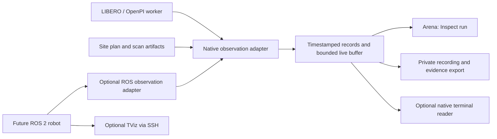

# An inspection layer for BrainSNN Arena

Research date: 2026-10-16. Proposal, not implemented functionality.

Local baseline: `d25054c1cf937a2cbee4390c9215b9f21ab25d3b` on
`codex/arena-review-consolidation`, stacked on the lobby change in PR #186.
Upstream TViz inspected at `74f5b5e7499560945fb194594b69d2608b6ecf0b`.
This was a source and architecture review; no ROS installation, real-robot
connection, TViz runtime trial, or named-policy GPU execution was performed.

## Recommendation

Build **Inspect run** inside Arena, backed by a small native observation and
recording contract. Use the same contract for a lightweight terminal reader if
SSH operations become necessary. Keep TViz as an optional tool for workers
that already use ROS 2. The current LIBERO/OpenPI worker does not use ROS.

The product question is: **At this moment, what input did the policy consume,
what action reached the environment, and what happened next?** Spatial overlays
should help answer that question. They are not another homepage or product in
the navigation.

The first screen remains the paused mission and Run button. Inspect appears
after a run, beside the existing timeline. Keep Review's four tabs intact.
Display capability gaps and the source of each layer beside the observation.

## What the screenshot's tool actually provides

[TViz / terminal_rviz](https://github.com/nathanshankar/terminal_rviz) is a native
C++ ROS 2 application with FTXUI and a Braille renderer. It displays existing
robot/sensor messages in an interactive terminal. SSH is useful because the
application can run beside the ROS graph while its terminal is remote; SSH
does not itself make remote ROS topics discoverable.

The upstream includes robot models, transforms, images, maps, point clouds,
laser scans, odometry, and paths. These are useful inspection inputs. The
viewer does not supply SLAM, a policy, sensor calibration, or proof that a robot
understands a room. Braille reduces displayed spatial detail; it is suitable
for remote diagnostics, while the browser can retain richer visual detail.

Source findings that affect adoption:

| Finding at the pinned revision | Integration consequence |
| --- | --- |
| `main` and `devel` resolve to the same commit. The README's “devel” feature distinction is stale. No GitHub releases were returned. | Pin the tested commit, not a presumed stable feature list. |
| CMake builds more than 30 display source files, including Nav2, MoveIt, rosbag and teleop. Plugins are registered in compiled source. | “Plugin support” is not a ready-made browser extension API. A custom plugin requires C++ integration and a rebuild. |
| `WITH_GPU` defaults **ON** in CMake; the runtime `use_gpu` parameter defaults **false**. | Explicitly use `-DWITH_GPU=OFF` for an initial CPU-only trial. Do not rely on the README's default wording. |
| `package.xml` declares `BSD-3-Clause`; there is no root license text, and GitHub's license field is null. | Record the declaration accurately. Resolve the missing notice/license file before packaging a redistributed fork. |
| GitHub's latest Foxy/Humble/Iron/Jazzy build jobs passed at this commit. The inspected Jazzy workflow builds but does not run an integration test suite. | Build success is useful evidence, but does not establish sensor compatibility, latency or robot-command behavior. |

Sources: [CMake](https://github.com/nathanshankar/terminal_rviz/blob/74f5b5e7499560945fb194594b69d2608b6ecf0b/CMakeLists.txt),
[package declaration](https://github.com/nathanshankar/terminal_rviz/blob/74f5b5e7499560945fb194594b69d2608b6ecf0b/package.xml),
[plugin guide](https://github.com/nathanshankar/terminal_rviz/blob/74f5b5e7499560945fb194594b69d2608b6ecf0b/PLUGIN_GUIDE.md),
[node registration](https://github.com/nathanshankar/terminal_rviz/blob/74f5b5e7499560945fb194594b69d2608b6ecf0b/src/terminal_rviz_node.cpp),
[Jazzy build run](https://github.com/nathanshankar/terminal_rviz/actions/runs/24031580168).

Three details require particular attention:

1. **The application can control a robot.** Nav2 sends navigation goals;
   teleop publishes Twist commands; motion planning has execution paths.
   There is no general read-only option in the inspected node entry point.
   For observation-only use, omit those modules in a dedicated build or enforce
   permissions at the ROS transport boundary. Hiding a UI panel is insufficient.
   See [Nav2 implementation](https://github.com/nathanshankar/terminal_rviz/blob/74f5b5e7499560945fb194594b69d2608b6ecf0b/src/displays/nav2_display.cpp)
   and [teleop implementation](https://github.com/nathanshankar/terminal_rviz/blob/74f5b5e7499560945fb194594b69d2608b6ecf0b/src/displays/teleop_display.cpp).
2. **Sensor QoS needs verification.** The point-cloud and image subscriptions
   use a depth of 10 with default reliability. A reliable subscriber cannot
   receive from a best-effort publisher. A topic may therefore be discoverable
   without producing a picture. The adapter should choose compatible QoS per
   topic and expose connection/staleness diagnostics. This is an inference from
   [the subscription code](https://github.com/nathanshankar/terminal_rviz/blob/74f5b5e7499560945fb194594b69d2608b6ecf0b/src/displays/pointcloud_display.cpp)
   and [ROS QoS rules](https://github.com/ros2/ros2_documentation/blob/jazzy/source/Concepts/Intermediate/About-Quality-of-Service-Settings.rst).
3. **A live display is not automatically a faithful replay.** Point-cloud,
   scan and odometry rendering use `tf2::TimePointZero`, requesting the latest
   transform. On a moving robot, a delayed observation can be placed using a
   different pose from its capture time. BrainSNN should resolve transforms at
   observation time and show “transform unavailable” when it cannot. See
   [point-cloud transform lookup](https://github.com/nathanshankar/terminal_rviz/blob/74f5b5e7499560945fb194594b69d2608b6ecf0b/src/displays/pointcloud_display.cpp)
   and [tf2's time-buffered model](https://github.com/ros2/ros2_documentation/blob/jazzy/source/Concepts/Intermediate/About-Tf2.rst).

## What BrainSNN already has, and the actual gaps

| Existing source | Already present | First change needed |
| --- | --- | --- |
| `workers/arena/core.py`, `Episode.frame()` | Simulator time, body positions/quaternions, spectator image, two policy images, camera capture step, metrics and events | Explicit frame conventions, observation/inference/action IDs, joint and contact telemetry |
| `Episode.advance()` / `Episode.evidence()` | Applied action per step, simulator state and hash, reward, task outcome, checkpoint identity | Persist a recording and link each action to its consumed observation; expose named state fields |
| `workers/arena/app.py` | Authenticated GET `/v1/sessions/{id}/evidence` | Browser retrieval, bounds, durable lifecycle and read-only authorization |
| `public/arena/arena-runtime.js` | Profile validation, session/sequence checks, camera/body validation, serialized commands | Validate optional telemetry capabilities and payloads; distinguish observation access from control |
| `public/arena/arena-workspace.js` | Timeline, metrics, event list, spectator plus first policy camera | Both policy views, synchronized spatial/action overlays and full evidence retrieval |
| `public/arena/site-core.js` and `src/arena/site-renderer.js` | Reviewed metric floor, obstacles, geometric route/coverage and optional scan appearance | Explicit site-to-robot registration, separately sourced observed path and map/sensor overlays |

The browser retains at most 180 observed frames and caps retained image URL
characters at 24 million. That accounting does not bound every future geometry
allocation. Export currently keeps frame metadata and camera identifiers,
omitting image URLs and physics state. It does not fetch the worker's complete
action/state evidence. A durable recorder is therefore a real missing feature,
not just a different rendering style.

There is also a fidelity distinction: `last_inference_images` retains the
processed arrays consumed by the policy, but browser previews are JPEG at
quality 85. Preserve those previews for browsing; use lossless arrays/images
and hashes when claiming exact policy-input evidence. The existing worker's
evidence response records states/actions, not the full input-image history.

The worker is Python 3.10 on Debian Bookworm with pinned LIBERO/OpenPI/MuJoCo
dependencies. Adding ROS to that container only to obtain a terminal picture
would introduce another runtime and dependency lifecycle. Start from its native
Python data instead.

## Architecture

These are separate source kinds; combining them does not upgrade their
evidence. A planned route remains a plan; a sparse reconstruction remains a
reconstruction; a simulator pose remains simulated; an observed hardware pose
remains a measurement with its own uncertainty.

Use the existing authenticated HTTPS transport for the first increment.
The current client polls roughly every 180 ms while running. That is a display
cadence, not the 20 Hz control contract. Record every applied action on the
worker, independently of browser sampling. Add a binary stream only when
measured payload size justifies it; a WebSocket is not necessary for the first
pose/action inspector.

Keep rendering and recording outside the policy critical path as far as
practical. Publish immutable snapshots into bounded queues. Slow viewers can
drop preview frames with counters; evidence recording must identify any gaps
and mark the recording incomplete. It must not silently stall physics or alter
policy inputs. Measure the effect on inference/step latency on the target host.

## Additive telemetry contract

Keep outer protocol `version:1` and the existing fields unchanged. Add an
optional capability such as `telemetry.schema = "brainsnn.arena.telemetry.v1"`
and a matching optional frame section. Old workers remain viewable. Validate
new fields only when advertised; missing data means unavailable, never zero.

Minimum record identity and semantics:

| Field group | Required meaning |
| --- | --- |
| Identity | Session, episode/reset epoch, frame sequence, control step, observation ID, inference ID, action/chunk index |
| Time | Capture time and clock domain, simulator/ROS time, receive time on a stated clock; do not subtract unsynchronized host clocks |
| Geometry | Parent/child frame IDs, transform direction, metric units, axis convention, explicit quaternion ordering |
| Actions | Actual vector passed to the controller, space/controller identity, source observation ID; planned actions separately identified |
| Sensors | Camera role, processed dimensions, capture step/time, lossless input hash, preview encoding; calibration for any projection |
| Provenance | Scripted practice / simulator / measured hardware / planner / reconstruction / derived diagnostic; source and version |
| Quality | Age, missing transforms, dropped records, uncertainty when supplied; unknown uncertainty is not perfect confidence |

The current body quaternion is MuJoCo `wxyz`, while policy observation
quaternions use `xyzw`. Do not silently change the old body format. Declare
the new format explicitly and convert once at the adapter boundary.

For ROS interoperability, use right-handed metric frames with explicit optical
camera frames. Mobile robots need meaningful `map`, `odom`, and `base_link`
relationships. Keep the distinction between globally corrected map poses and
continuous but drifting odometry. See [REP-103](https://github.com/ros-infrastructure/rep/blob/master/rep-0103.rst)
and [REP-105](https://github.com/ros-infrastructure/rep/blob/master/rep-0105.rst).

The site renderer uses Y-up, with its floor in X/Z. ROS uses Z-up. One
right-handed display conversion is `(x,y,z) -> (x,z,-y)`; this is only an axis
conversion, not site localization. A separate reviewed rigid transform must
align origin and heading. The RoomPlan importer currently recenters the floor
by subtracting its minimum X/Z coordinates; retain that source transform in
future imports so registration is reproducible. Never align an unscaled COLMAP
cloud to a metric robot by appearance alone.

Useful optional ROS mappings:

| Source | Inspector use |
| --- | --- |
| `/tf`, `/tf_static`, `/joint_states` | Frames, link poses, named joints |
| Image + CameraInfo | Camera view and calibrated frustum; depth only if actually supplied |
| PointCloud2 / LaserScan | Measured geometry at capture-time pose |
| OccupancyGrid / planner Path | Map and planned route, with separate provenance |
| Odometry / localization pose | Observed movement and supplied covariance |
| Action status / diagnostics | Mission outcome and system events |

Topic names beyond the standard examples are configurable. Never reinterpret
the Panda's seven-dimensional Cartesian/gripper action as joint positions or
as a mobile robot's velocity command.

## Recording and resource limits

First connect the existing authenticated evidence endpoint to an explicit
download. Label it as state/action evidence and report its limits. Then add a
private per-run manifest plus lossless sensor artifacts, recorded independently
of the browser. A manifest should include profile and code revisions, seed,
task, scene digest, clock/frame conventions, evaluator version, artifact hashes,
recording completeness and intervention history.

MCAP is a sensible later container for timestamped channels and attachments;
it can carry non-ROS schemas, so choosing it need not make ROS mandatory.
ROS users can record MCAP through rosbag2. Arbitrary BrainSNN channels still
need documented schemas/readers; a `.mcap` suffix alone does not make them
viewable in every tool. See [MCAP specification](https://mcap.dev/spec) and
[ROS 2 recording support](https://mcap.dev/guides/getting-started/ros-2).

Keep credentials out of exported artifacts, URLs and public static files.
Session TTL currently destroys transient state, so persist a completed run
before session cleanup. Start with local/private exports; public sharing needs
separate retention and access decisions. This adds no email capture or paid
action before a named model has actually run.

Proposed initial preview budgets, to validate on target hardware:

- Poses/actions: up to 10 Hz display updates; record each executed control step.
- Camera previews: 2–5 Hz, with a separate lossless capture at policy inference.
- Clouds: at most 10,000 displayed points at 5 Hz initially, with original
  artifacts kept separately when recording is enabled.
- Static maps/meshes: transfer on change and cache by content digest.
- Bound all decoded arrays, allocations and queues; show dropped counts.

For scale: 100,000 points × 16 bytes × 10 Hz is **16 MB/s** before overhead.
10,000 × 16 × 5 Hz is **0.8 MB/s**, also before overhead. These are illustrative
payload calculations, not measured TViz or BrainSNN performance. Decimation
must be recorded as a display choice and must never replace policy inputs.

## Build choices

| Choice | Best use | Recommendation |
| --- | --- | --- |
| Native Arena inspector with existing worker/Three.js code | Consistent product flow, current MuJoCo worker, site comparison | Build first |
| Native small terminal reader of the same records | Inspect current non-ROS workers over SSH | Add when remote operations justify it; share schema and validation |
| Pinned TViz beside an existing ROS graph | Fast remote inspection of ROS topics | Optional operator tool; test read-only behavior and QoS |
| Foxglove | External ROS/MCAP engineering inspection and comparison | Useful reference tool; not a required BrainSNN runtime |
| Embed a shell/TViz in the public browser | Literal terminal aesthetic | Poor first fit: adds terminal/session/control plumbing and does not solve evidence fidelity |

Foxglove already supports live ROS connections and recording-file inspection,
so there is little value in reproducing its complete engineering dashboard.
BrainSNN's narrower contribution should be connecting a mission's input,
applied action, outcome and limitations. See [Foxglove data connections](https://docs.foxglove.dev/docs/visualization/connecting)
and [bridge documentation](https://docs.foxglove.dev/docs/fleet/bridge).

## Implementation sequence and acceptance

1. **Inspect a current Arena run.** Reuse the existing timeline. Show both
   policy cameras, spectator, input capture step, actual applied action, body
   axes/positions and outcome events. Add IDs/time semantics and connect the
   worker evidence endpoint. Unsupported fields stay visibly unavailable.
   Acceptance: a deterministic fixture maps one inference to its five applied
   actions, all panels scrub together, reset cannot mix episodes, and the old
   v1 client/worker contract still works.
2. **Keep a complete run.** Record inputs, state/actions and source identity
   with lossless artifacts and checksums. Add read-only observer authorization
   independently of control authorization. Acceptance: after browser refresh
   and worker session cleanup, the recording reproduces the same observations;
   missing records are detected, and observer credentials cannot invoke any
   mutation. Playback is observation review, not causal physics restoration.
3. **Inspect a site run.** Overlay registered map/scan, planned path and actual
   observed route. Acceptance: an asymmetric calibration fixture catches axis
   and quaternion mistakes; a known metric distance survives import; stale
   transforms and unscaled scans cannot produce asserted clearance/coverage.
   This stage requires a real mobile-robot or simulation data source for the
   observed route. The existing geometric planner supplies only the plan.
4. **Add ROS and terminal access where useful.** Test on an isolated recorded
   ROS graph first. Validate best-effort sensors, retained static transforms,
   delayed messages, missing frames and bag seek/reset. Pin dependencies and
   use the CPU renderer initially. Accept only after verifying that the chosen
   observer cannot send goals, velocities or motion execution requests.

Cross-cutting checks: opening/closing the inspector must not alter applied
actions; a slow viewer must not change stepped simulation results; transport
loss must be visible; mobile layout must preserve the paused-mission first
screen; one actual named-policy execution on the intended worker is required
before demonstrating this as live model evidence.

A useful first demonstration is a single camera-occlusion mission: inspect the
actual processed input, follow the resulting action chunk, and locate the
worker's outcome event. It supports the lobby promise of seeing the failure
moment without claiming the visualizer has inferred why the policy failed.
